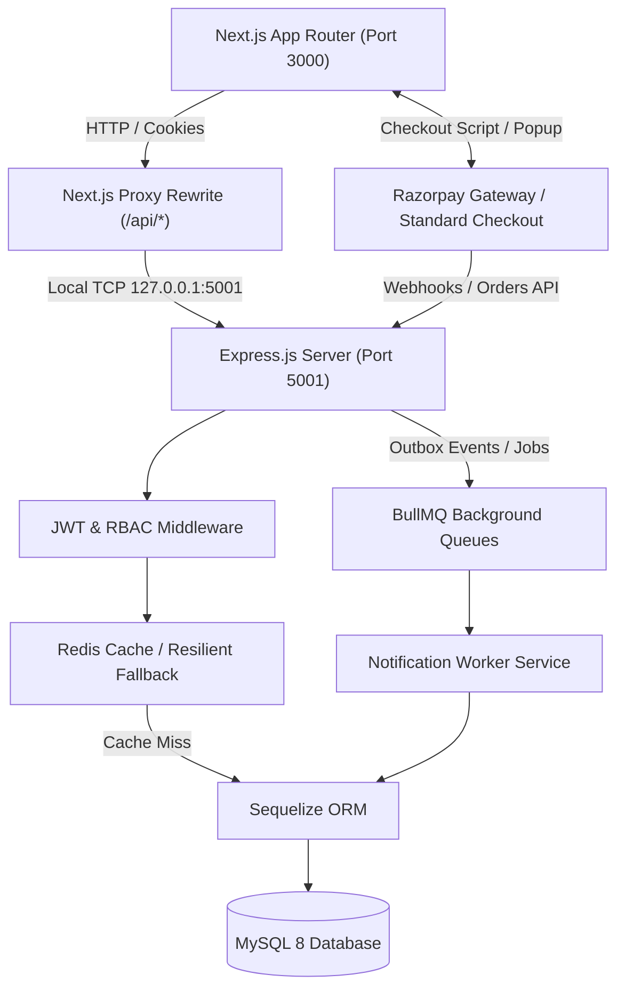
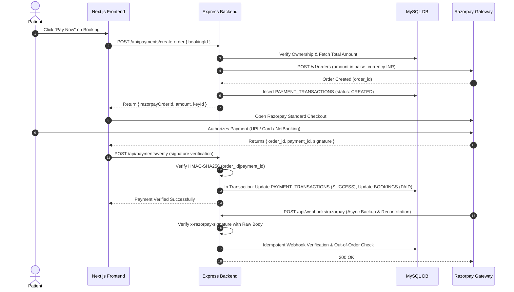
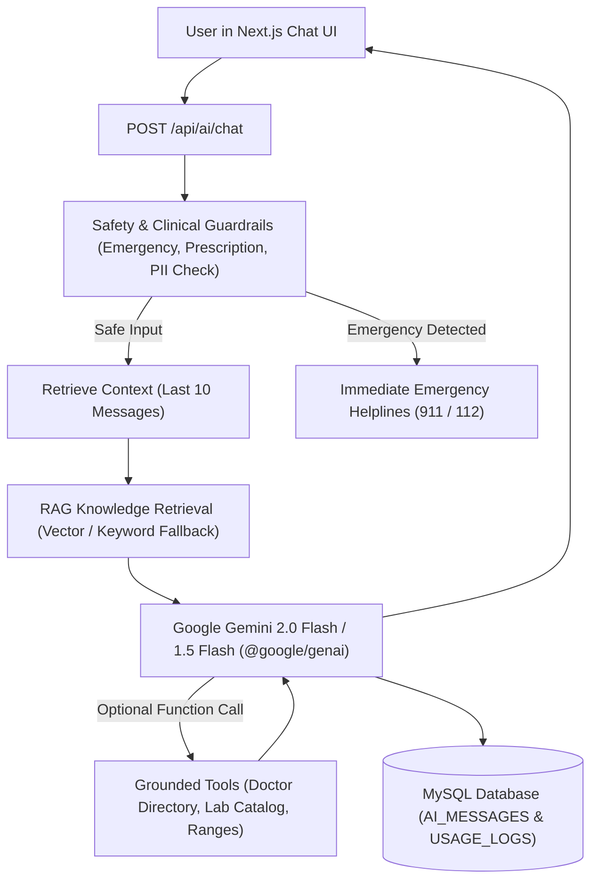
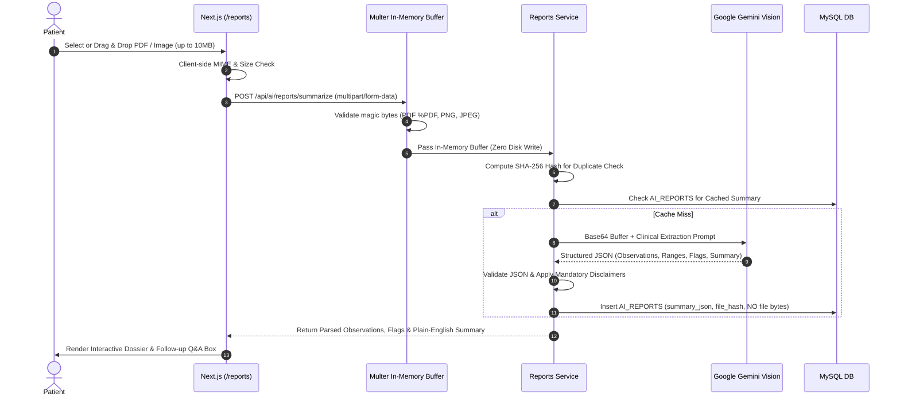
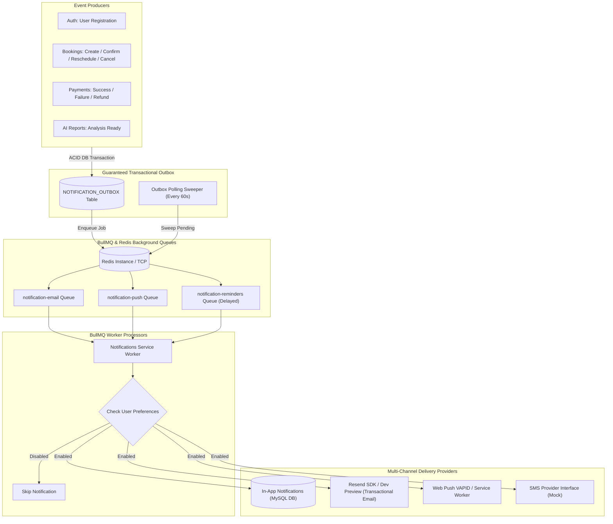
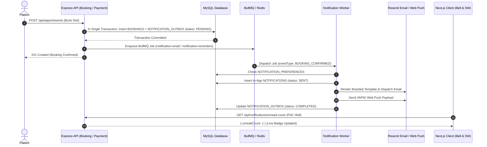
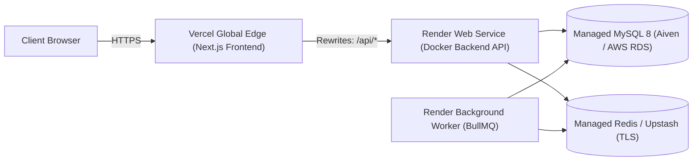

# HealthSync AI — Modern Healthcare Platform

HealthSync AI is a modern clinical SaaS web application designed to unify patient diagnostic ordering, specialist consultations, pathology assays, preventive checkups, and administrative governance under an intelligent, secure, and responsive platform.

---

## 1. Project Overview

- **Mission:** Streamline clinical diagnostics, medical specialist discovery, and patient sample logistics with speed, transparency, and data privacy.
- **Primary Audience:**
  - **Patients:** Discover certified doctors, inspect weekly availability, search pathology tests, review bundled packages, manage sample collection addresses, view notifications, and analyze lab reports.
  - **Doctors:** Publish specialty credentials, consult fees, clinic locations, and weekly consultation schedules.
  - **Administrators:** Oversee user accounts, enforce Role-Based Access Control (RBAC), manage doctor directories, update clinical test/package catalogs, monitor notifications outbox, and govern AI knowledge base.

---

## 2. Technology Stack

### Frontend
- **Framework:** Next.js 16 (App Router, JavaScript)
- **UI & Styling:** Tailwind CSS v4, custom glassmorphism panels, Lucide React icons
- **State & Context:** React 19, Context API, in-memory token management
- **Forms & Validation:** React Hook Form, Zod
- **Data Visualization & Toasts:** Recharts, Sonner
- **Push Notifications:** Standard Browser Push API & Service Worker (`/sw.js`)

### Backend
- **Runtime:** Node.js 22+
- **Server:** Express.js 5
- **ORM:** Sequelize 6
- **Database:** MySQL 8
- **Background Queues & Caching:** BullMQ, Redis (with resilient automatic in-memory fallback)
- **Notification Services:** Resend Node.js SDK (transactional email with development preview fallback), Web Push (VAPID / Service Worker), Mock SMS interface
- **AI & Multimodal Vision:** Google Gemini 2.0 Flash / 1.5 Flash via `@google/genai`
- **Security & Validation:** JWT (Access Token + HttpOnly Refresh Cookie rotation), bcryptjs, Helmet, CORS, Zod

---

## 3. Project Architecture



### Payment Processing Flow



### AI Health Assistant Chat & Grounded Tool Flow



### In-Memory Medical Report Summarization Flow



### Central Notification Architecture & Outbox Pattern



### Booking-to-Notification Outbox Workflow



### BullMQ Background Worker & Retry Pipeline

```mermaid
flowchart LR
    Job["BullMQ Notification Job"] --> Attempt{"Attempt <= 5?"}
    Attempt -->|Yes| Exec["Execute Provider Delivery"]
    Exec --> Result{"Success?"}
    Result -->|Success| Complete["Mark Outbox: COMPLETED"]
    Result -->|Failure| Backoff["Exponential Backoff Delay (1s, 2s, 4s, 8s, 16s)"]
    Backoff --> Job
    Attempt -->|Exceeded (Attempt > 5)| DeadLetter["Mark Outbox: FAILED"]
    DeadLetter --> AdminAction["Admin Notification Dashboard (Manual Retry Trigger)"]
```

---

## 4. Project Folder Structure

```
healthsync-ai/
├── backend/
│   ├── src/
│   │   ├── config/              # Database connection & Sequelize instance
│   │   ├── middleware/          # JWT authentication & allowRoles RBAC middleware
│   │   ├── models/              # Sequelize models (User, Doctor, Booking, Payment, AI, Notification, etc.)
│   │   ├── modules/
│   │   │   ├── admin/           # Admin user management & RBAC governance
│   │   │   ├── ai/              # Gemini chat, report summarizer, safety, tools, RAG knowledge
│   │   │   ├── appointments/    # Doctor appointment scheduling, slots & rescheduling
│   │   │   ├── auth/            # Auth register, login, refresh, logout, me
│   │   │   ├── bookings/        # Orders, lab & package bookings, admin governance
│   │   │   ├── doctors/         # Doctor management & weekly availability
│   │   │   ├── lab-tests/       # Clinical lab test catalog
│   │   │   ├── notifications/   # Central Notification Service, BullMQ queues, workers, outbox, templates & providers
│   │   │   ├── packages/        # Bundled diagnostic packages & mappings
│   │   │   ├── payments/        # Razorpay checkout, verification, webhooks & refunds
│   │   │   ├── search/          # Global multi-entity healthcare search
│   │   │   └── users/           # Patient profile & address logistics
│   │   ├── scripts/             # Phase-wise idempotent database migration scripts
│   │   ├── tests/               # Automated unit and integration test suites (Phases 2-7)
│   │   ├── utils/               # Token hashing, Razorpay client & Redis caching helper
│   │   ├── app.js               # Express application router assembly
│   │   └── server.js            # Server entry point & auto-column synchronizer
│   ├── package.json
│   └── .env
├── frontend/
│   ├── app/
│   │   ├── dashboard/
│   │   │   ├── addresses/       # Patient sample collection addresses
│   │   │   ├── admin/
│   │   │   │   ├── ai-knowledge/# Admin RAG knowledge base & token usage analytics
│   │   │   │   ├── bookings/    # Admin platform-wide booking & order management
│   │   │   │   ├── doctors/     # Admin doctor directory management
│   │   │   │   ├── lab-tests/   # Admin test catalog management
│   │   │   │   ├── notifications/# Admin notification outbox monitoring & retry
│   │   │   │   ├── packages/    # Admin package catalog management
│   │   │   │   ├── payments/    # Admin financial & refund governance
│   │   │   │   └── users/       # Admin user governance & role updates
│   │   │   ├── ai-assistant/    # Gemini AI conversational healthcare assistant
│   │   │   │   └── reports/     # In-memory medical report analysis & [id] dossier
│   │   │   ├── bookings/        # Appointments, lab orders & [id]/payment
│   │   │   ├── notifications/   # Patient In-App Notification Center
│   │   │   ├── payment/result/  # Payment success/failure verification result
│   │   │   ├── payments/        # Patient payment history & [id] dossier
│   │   │   ├── doctors/         # Public doctor directory & [id] details
│   │   │   ├── lab-tests/       # Public clinical test catalog
│   │   │   ├── packages/        # Public diagnostic packages & [id] details
│   │   │   ├── profile/         # Patient profile & identity settings
│   │   │   ├── settings/
│   │   │   │   └── notifications/# Granular channel & category preference toggles + Web Push enrollment
│   │   │   ├── tests/           # Laboratory search & package explorer
│   │   │   └── page.jsx         # Dashboard overview & analytics
│   │   ├── login/               # Split-screen patient/doctor sign-in
│   │   ├── register/            # Secure patient account creation
│   │   ├── layout.jsx
│   │   └── page.jsx             # Public landing page
│   ├── components/
│   │   ├── common/              # Button, Input, Modal, Badge, EmptyState, Loader
│   │   ├── healthcare/          # GlobalSearch, TestCard, PackageCard, MarkdownMessage
│   │   └── layout/              # Navbar, Sidebar, DashboardHeader (Bell counter), Footer
│   ├── context/                 # AuthContext (in-memory access tokens, session refresh)
│   ├── lib/                     # Universal API client with auto-refresh retry
│   ├── public/
│   │   └── sw.js                # Service Worker for background Web Push notification display & click handling
│   ├── services/                # API client services (ai, doctors, tests, packages, notifications, users, search)
│   ├── next.config.mjs
│   └── package.json
└── README.md
```

---

## 5. Phase-wise Development

| Phase | Module | Functionality | Status |
|---|---|---|---|
| **Phase 1** | Foundation & Authentication | Next.js 16 UI, Express 5, MySQL connection, JWT authentication, HttpOnly refresh token rotation, public landing page, dashboard overview | **Completed** |
| **Phase 2** | User & Access Management | Patient profile management, collection addresses (transactions, single default address rule), RBAC `allowRoles` middleware, admin user management | **Completed** |
| **Phase 3** | Healthcare Catalog | Doctor directory, weekly consultation availability, clinical lab tests, diagnostic packages (package-test mappings), global search, Redis caching | **Completed** |
| **Phase 4** | Appointment & Lab Booking | Real-time slot reservation, home sample pickup booking, order management, status tracking, admin bookings | **Completed** |
| **Phase 5** | Payment Integration | Razorpay gateway checkout, cryptographic verification, webhooks, retries, refunds, reconciliation | **Completed** |
| **Phase 6** | AI Healthcare Assistant | Gemini clinical chat, in-memory medical report summaries, observation extraction, grounded tools, RAG knowledge | **Completed** |
| **Phase 7** | Notifications & Background Jobs | Central Notification Service, BullMQ queues, 11 transactional email templates (Resend), Web Push (VAPID), delayed reminders, outbox pattern | **Completed** |
| **Phase 8** | Deployment & Optimization | Cloud CDN deployment, production monitoring, distributed rate limiting, audit logging | *Planned* |

---

## 6. Implemented Features

### Phase 1: Foundation & Authentication
- Next.js 16 App Router interface styled with Tailwind CSS v4.
- In-memory access token storage (no tokens stored in localStorage).
- Automatic token rotation with single in-flight refresh promise and 401 retry.
- Medical landing page with service exploration and hero search.

### Phase 2: User Profile, Addresses & RBAC
- Profile management with read-only email safeguards and past date-of-birth validation.
- Transactional address logistics ensuring exactly one default address with automatic reassignment upon deletion.
- RBAC middleware (`allowRoles`) protecting endpoints across `PATIENT`, `DOCTOR`, and `ADMIN`.
- Admin user management with search, pagination, role alteration, and self-deactivation safeguards.

### Phase 3: Healthcare Catalog, Availability & Search
- **Doctor Directory:** Public listing, specialty filters, fee sorting, pagination, and dedicated doctor detail view.
- **Doctor Availability:** Weekly consultation windows with overlap prevention validation (`startTime < endTime`, non-overlapping same-day intervals).
- **Lab Tests Catalog:** Individual pathology assays, sample types, preparation directives, and fasting window indicators.
- **Diagnostic Packages:** Curated bundled panels with `PACKAGE_TESTS` many-to-many mappings, test counts, and validated bundle savings (`offerPrice <= originalPrice`).
- **Global Healthcare Search:** Real-time multi-entity search querying doctors, lab tests, and packages.
- **Redis Multi-Tier Caching:** Cache-aside pattern for catalog lists and search queries with automatic fallback if Redis is offline.
- **Admin Catalog Management:** Complete administrative CRUD pages for doctors, availability schedules, lab tests, and packages.

### Phase 4: Appointment & Lab Booking Management
- **Doctor Consultations:** Double-booking prevention via row-locked transactions, real-time doctor availability slot query, dynamic time-slot calculation, and appointment rescheduling.
- **Lab & Package Orders:** Direct test and bundled diagnostic package booking with home specimen phlebotomy pickup logistics.
- **Authoritative DB Pricing:** Server-side pricing recalculation and item snapshots at booking time to prevent client price tampering.
- **Collection Logistics:** Address ownership verification (IDOR protection) and specimen tracking states (`PENDING`, `SCHEDULED`, `COLLECTED`, `RECEIVED_AT_LAB`).
- **Admin Booking Governance:** Platform-wide order list, cancellation reason handling, and multi-state status transitions.

### Phase 5: Payment Gateway Integration & Transaction Management
- **Razorpay Standard Checkout:** Server-mediated order creation (amount in paise, INR currency, idempotency keys).
- **Cryptographic Verification:** Constant-time `crypto.timingSafeEqual` HMAC-SHA256 signature verification (`order_id|payment_id`).
- **Resilient Webhook Pipeline:** Raw-body signature verification handling asynchronous webhooks (`payment.captured`, `payment.failed`, `order.paid`, `refund.processed`) with deduplication.
- **Retry & Refund Workflows:** Payment retries for failed attempts, admin-initiated full/partial refunds via Razorpay Refund API, and comprehensive transaction dossiers.

### Phase 6: AI Healthcare Assistant & Clinical Intelligence
- **Dual-Mode Conversational Assistant:** Powered by Google Gemini (`gemini-2.0-flash` / `gemini-1.5-flash`) via `@google/genai` with clinical safety guardrails, emergency detection (auto-redirecting to emergency helplines 911/112), and conversational memory.
- **Grounded Tool Calling:** Native LLM tool execution querying doctor appointments, lab test preparation instructions, and reference ranges directly from the verified database.
- **Plain-Language Medical Report Summarization:** Accepts PDF, PNG, and JPEG lab reports up to 10MB; extracts a structured observations table (`parameter`, `reportedValue`, `unit`, `referenceRange`, `documentFlag` displayed as "flag from document", and uncertainty markers); generates plain-English summary, terms explained, questions for doctor, limitations, and interactive follow-up Q&A.
- **Zero-Disk In-Memory Privacy:** Uploaded medical files are held strictly in memory buffers (`multer.memoryStorage()`), streamed to the Gemini Multimodal Vision API as base64, and instantly garbage-collected — zero file bytes are ever written to disk or stored in MySQL.
- **Enterprise RAG Knowledge Base:** Admin-governed repository of verified clinical FAQs, preparation guidelines, and terminology; features hybrid semantic vector retrieval with Gemini embeddings and automatic fallback to MySQL `FULLTEXT` keyword search when vector storage is unconfigured.
- **Token & Rate Governance:** Sliding-window rate limiting (requests/min, daily chat quotas, daily report quotas), token usage recording in `AI_USAGE_LOGS`, and 7-day administrative usage analytics.

### Phase 7: Notification System, BullMQ, Redis & Background Jobs
- **Guaranteed Transactional Outbox Pattern:** Outbox records (`NOTIFICATION_OUTBOX`) are written inside the exact same database transaction as the business event (booking creation, payment capture, doctor confirmation, or AI report readiness), guaranteeing zero message loss even during process termination.
- **In-App Notification Center:** Real-time patient notification inbox (`/dashboard/notifications`) with category filters (`ALL`, `APPOINTMENT`, `LAB`, `PAYMENT`, `AI_REPORT`), relative time display, read/unread states, mark-as-read, delete, and pagination.
- **Live Header Notification Bell:** Live badge counter in the dashboard navigation bar polling unread count every 45s, accompanied by an instant preview dropdown and direct links to details.
- **Responsive Transactional Emails:** 11 styled HTML and plain-text fallback templates powered by the Resend SDK (`WELCOME`, `BOOKING_CREATED`, `BOOKING_CONFIRMED`, `BOOKING_CANCELLED`, `BOOKING_RESCHEDULED`, `REMINDER_APPOINTMENT`, `REMINDER_LAB_COLLECTION`, `PAYMENT_SUCCESS`, `PAYMENT_FAILED`, `REFUND_PROCESSED`, `AI_REPORT_READY`). In development environments without an API key, templates automatically output full formatted terminal previews.
- **Browser Web Push Notifications:** Powered by the `web-push` package and standard VAPID authentication. Includes service worker registration (`frontend/public/sw.js`), permission prompt handling, subscription storage with SHA-256 hash deduplication, and automatic cleanup of expired endpoints (HTTP 404 / 410).
- **BullMQ Background Queues:** Dedicated background queues (`notification-email`, `notification-push`, `notification-reminders`) with automatic exponential backoff (1s, 2s, 4s, 8s, 16s), bounded retries, and graceful in-memory execution fallback when Redis is offline.
- **Automated Delayed Reminders:** Background reminder scheduler for doctor appointments (24 hours prior) and lab home collections (12 hours prior with fasting directives). Reminders verify real-time booking status before dispatch, automatically aborting if the appointment was cancelled or rescheduled.
- **Granular User Preferences:** Patient-controlled preference center (`/dashboard/settings/notifications`) with toggles for delivery channels (Email, Web Push, SMS) and notification event categories (`appointmentReminders`, `bookingUpdates`, `paymentUpdates`, `reportUpdates`).
- **Administrative Notification Monitoring:** Central admin dashboard (`/dashboard/admin/notifications`) with real-time metrics (total sent, pending outbox, failed delivery, channel distribution), notification history filters, and 1-click retry for failed outbox entries.

---

## 7. Database Tables

| Table Name | Description | Key Columns / Constraints |
|---|---|---|
| `USERS` | Registered patient, doctor, and admin accounts | `id`, `name`, `email` (unique), `password`, `role`, `status`, `phone`, `date_of_birth`, `gender`, `profile_image_url` |
| `REFRESH_TOKENS` | Cryptographically hashed refresh sessions | `id`, `user_id` (FK USERS), `token_hash` (unique), `expires_at`, `revoked_at` |
| `USER_ADDRESSES` | Specimen collection and home phlebotomy addresses | `id`, `user_id` (FK USERS), `address_type`, `full_name`, `phone`, `address_line1`, `city`, `state`, `pincode`, `is_default` |
| `DOCTORS` | Clinical doctors and specialists directory | `id`, `user_id` (FK USERS, nullable), `doctor_name`, `specialization`, `qualification`, `experience_years`, `consultation_fee`, `about`, `city`, `pincode`, `status` |
| `DOCTOR_AVAILABILITY` | Weekly practitioner consultation schedules | `id`, `doctor_id` (FK DOCTORS), `day_of_week`, `start_time`, `end_time`, `slot_duration`, `is_available` |
| `LAB_TESTS` | Individual clinical diagnostic assays | `id`, `test_name`, `test_code` (unique), `description`, `category`, `sample_type`, `fasting_required`, `preparation_instructions`, `price`, `status` |
| `DIAGNOSTIC_PACKAGES` | Bundled preventive diagnostic panels | `id`, `package_name`, `package_code` (unique), `description`, `image`, `original_price`, `offer_price`, `status` |
| `PACKAGE_TESTS` | Many-to-many junction mapping tests to packages | `id`, `package_id` (FK DIAGNOSTIC_PACKAGES), `lab_test_id` (FK LAB_TESTS), Unique `(package_id, lab_test_id)` |
| `BOOKINGS` | Master booking record across doctors, tests, and packages | `id`, `booking_number` (unique), `user_id` (FK USERS), `booking_type`, `booking_status`, `payment_status`, `subtotal`, `discount_amount`, `total_amount`, `address_id` (FK USER_ADDRESSES), `booking_date`, `time_slot` |
| `BOOKING_ITEMS` | Snapshot of booked tests or packages | `id`, `booking_id` (FK BOOKINGS), `item_type`, `item_id`, `item_name`, `price` |
| `DOCTOR_APPOINTMENTS` | Doctor consultation appointment details | `id`, `booking_id` (FK BOOKINGS), `doctor_id` (FK DOCTORS), `patient_name`, `appointment_date`, `start_time`, `end_time`, `status` |
| `SAMPLE_COLLECTIONS` | Home phlebotomy sample pickup logistics | `id`, `booking_id` (FK BOOKINGS), `address_id` (FK USER_ADDRESSES), `collection_date`, `time_slot`, `phlebotomist_name`, `sample_status` |
| `PAYMENT_TRANSACTIONS` | Gateway transaction records and signatures | `id`, `booking_id` (FK BOOKINGS), `user_id` (FK USERS), `razorpay_order_id`, `razorpay_payment_id`, `amount`, `currency`, `status`, `idempotency_key` (unique) |
| `PAYMENT_REFUNDS` | Refund audit log and gateway refund identifiers | `id`, `payment_transaction_id` (FK PAYMENT_TRANSACTIONS), `razorpay_refund_id`, `amount`, `status`, `reason`, `processed_by` (FK USERS) |
| `AI_CONVERSATIONS` | Conversational threads with AI health assistant | `id`, `user_id` (FK USERS), `title`, `last_message_at` |
| `AI_MESSAGES` | Individual dialog turns with citations | `id`, `conversation_id` (FK AI_CONVERSATIONS), `role` (`USER`/`ASSISTANT`), `content`, `sources_json` |
| `AI_REPORTS` | Metadata and structured summaries for uploaded lab reports | `id`, `public_id` (UUID unique), `user_id` (FK USERS), `file_name`, `file_type`, `file_size`, `file_hash` (SHA-256), `summary_json`, `processing_status`, `error_message` |
| `AI_KNOWLEDGE_DOCUMENTS` | Curated clinical knowledge base documents | `id`, `title`, `source_type` (`FAQ`/`LAB_TEST`/`TERMINOLOGY`/`PREPARATION`/`EDUCATIONAL`/`DOCUMENTATION`), `source_reference`, `content`, `content_hash`, `indexing_status`, `retrieval_mode`, `chunk_count`, `last_indexed_at`, `created_by` (FK USERS) |
| `AI_KNOWLEDGE_CHUNKS` | Semantic chunks with vector ID and FULLTEXT search | `id`, `document_id` (FK AI_KNOWLEDGE_DOCUMENTS), `chunk_index`, `content` (FULLTEXT index `ftx_ai_chunks_content`), `vector_id` |
| `AI_USAGE_LOGS` | Token metering and daily quota consumption | `id`, `user_id` (FK USERS, nullable), `feature` (`CHAT`/`REPORT_SUMMARY`/`REPORT_QUESTION`/`EMBEDDING`), `model`, `input_tokens`, `output_tokens`, `status`, `error_code` |
| `NOTIFICATIONS` | Patient In-App notifications and delivery logs | `id`, `user_id` (FK USERS), `title`, `message`, `channel` (`IN_APP`/`EMAIL`/`PUSH`/`SMS`), `notification_type` (`WELCOME`/`BOOKING_CREATED`/`BOOKING_CONFIRMED`/`BOOKING_CANCELLED`/`BOOKING_RESCHEDULED`/`APPOINTMENT_REMINDER`/`LAB_COLLECTION_REMINDER`/`PAYMENT_SUCCESS`/`PAYMENT_FAILED`/`REFUND_PROCESSED`/`AI_REPORT_READY`), `status` (`PENDING`/`QUEUED`/`SENT`/`FAILED`/`READ`), `metadata` (JSON), `read_at`, `created_at` |
| `NOTIFICATION_PREFERENCES` | User notification channel and category opt-ins | `id`, `user_id` (FK USERS, unique), `email_enabled`, `push_enabled`, `sms_enabled`, `appointment_reminders`, `booking_updates`, `payment_updates`, `report_updates` |
| `PUSH_SUBSCRIPTIONS` | Browser Web Push endpoint and VAPID keys | `id`, `user_id` (FK USERS), `endpoint` (TEXT), `endpoint_hash` (CHAR 64 unique per user), `p256dh_key`, `auth_key`, `device_name`, `is_active` |
| `NOTIFICATION_OUTBOX` | Transactional outbox for guaranteed message dispatch | `id`, `aggregate_type`, `aggregate_id`, `event_type`, `payload` (JSON), `status` (`PENDING`/`PROCESSING`/`COMPLETED`/`FAILED`), `attempts`, `last_error`, `processed_at`, `created_at` |

---

## 8. API Documentation

### Authentication (`/api/auth`)
- `POST /api/auth/register` — Create patient account (dispatches WELCOME notification)
- `POST /api/auth/login` — Sign in and receive access token + HttpOnly refresh cookie
- `POST /api/auth/refresh` — Rotate refresh token and obtain new access token
- `POST /api/auth/logout` — Revoke session and clear cookies
- `GET  /api/auth/me` — Inspect authenticated user profile

### User Profile & Addresses (`/api/users`)
- `GET    /api/users/profile` — Fetch logged-in user profile
- `PUT    /api/users/profile` — Update personal details (read-only email protected)
- `GET    /api/users/addresses` — List user's saved collection addresses
- `POST   /api/users/addresses` — Add a new collection address
- `PUT    /api/users/addresses/:id` — Update address details
- `PATCH  /api/users/addresses/:id/default` — Set primary collection address
- `DELETE /api/users/addresses/:id` — Remove address (auto-promotes next address if default)

### Doctors & Availability (`/api/doctors` & `/api/admin/doctors`)
- `GET    /api/doctors` — Public list of active doctors with filters and pagination
- `GET    /api/doctors/specializations` — List unique medical specializations
- `GET    /api/doctors/:id` — Public doctor profile details
- `GET    /api/doctors/:id/availability` — Public weekly consultation hours
- `GET    /api/admin/doctors` — Admin list of all doctors (including inactive)
- `POST   /api/admin/doctors` — Admin create doctor
- `GET    /api/admin/doctors/:id` — Admin view doctor details
- `PUT    /api/admin/doctors/:id` — Admin update doctor details
- `PATCH  /api/admin/doctors/:id/status` — Admin activate/deactivate doctor
- `DELETE /api/admin/doctors/:id` — Admin soft-delete doctor
- `POST   /api/admin/doctors/:id/availability` — Admin add consultation schedule (validated against overlaps)
- `PUT    /api/admin/doctors/:id/availability/:slotId` — Admin update consultation schedule
- `DELETE /api/admin/doctors/:id/availability/:slotId` — Admin delete consultation schedule

### Lab Tests (`/api/lab-tests` & `/api/admin/lab-tests`)
- `GET    /api/lab-tests` — Public active tests with search, category, fasting, price filter
- `GET    /api/lab-tests/categories` — List unique laboratory categories
- `GET    /api/lab-tests/:id` — Public test details
- `GET    /api/admin/lab-tests` — Admin list of all tests
- `POST   /api/admin/lab-tests` — Admin create lab test
- `GET    /api/admin/lab-tests/:id` — Admin view test details
- `PUT    /api/admin/lab-tests/:id` — Admin update lab test
- `PATCH  /api/admin/lab-tests/:id/status` — Admin activate/deactivate test
- `DELETE /api/admin/lab-tests/:id` — Admin soft-delete test

### Diagnostic Packages (`/api/packages` & `/api/admin/packages`)
- `GET    /api/packages` — Public list of packages with savings and test counts
- `GET    /api/packages/:id` — Public package details with included tests array
- `GET    /api/admin/packages` — Admin list of all packages
- `POST   /api/admin/packages` — Admin create package with test mappings (`offerPrice <= originalPrice`)
- `GET    /api/admin/packages/:id` — Admin view package details with mapped tests
- `PUT    /api/admin/packages/:id` — Admin update package and test mappings in transaction
- `PATCH  /api/admin/packages/:id/status` — Admin activate/deactivate package
- `DELETE /api/admin/packages/:id` — Admin soft-delete package

### Global Healthcare Search (`/api/search`)
- `GET /api/search?q=&type=&city=&pincode=&limit=&page=` — Multi-entity search across doctors, tests, and packages with Redis caching

### Doctor Appointments (`/api/appointments`)
- `GET   /api/appointments/slots?doctorId=&date=` — Query available slots (dynamic calculation & conflict detection)
- `GET   /api/doctors/:id/slots?date=` — Direct doctor slot query
- `POST  /api/appointments` — Book doctor consultation (double-booking protection via row-locked transaction; enqueues confirmation & 24h reminder)
- `GET   /api/appointments/my` — Get logged-in user's scheduled appointments
- `GET   /api/appointments/:id` — Get single appointment details
- `PATCH /api/appointments/:id/cancel` — Cancel appointment (dispatches cancellation notification & aborts scheduled reminder)
- `PATCH /api/appointments/:id/reschedule` — Reschedule appointment to a new date/slot (dispatches reschedule notification & reschedules reminder)

### Lab & Package Bookings (`/api/bookings`)
- `POST  /api/bookings` — Create lab test or diagnostic package booking (authoritative DB pricing snapshot, home collection IDOR validation, enqueues 12h collection reminder)
- `GET   /api/bookings` — List authenticated user's booking history
- `GET   /api/bookings/:id` — View booking details with item snapshots and sample tracking
- `PATCH /api/bookings/:id/cancel` — Cancel booking and associated collection/appointment

### Admin Booking Governance (`/api/admin/bookings`)
- `GET   /api/admin/bookings` — List all platform bookings with pagination, service type, status filter, and search
- `GET   /api/admin/bookings/:id` — View full booking record with patient dossier
- `PATCH /api/admin/bookings/:id/status` — Update booking, payment, sample, or appointment statuses
- `PATCH /api/admin/bookings/:id/cancel` — Cancel any booking administratively

### Patient Payments (`/api/payments`)
- `POST /api/payments/create-order` — Initiate payment order via Razorpay Orders API (amount in paise, idempotency key)
- `POST /api/payments/verify` — Verify checkout signature using HMAC SHA256, update booking to PAID, and dispatch PAYMENT_SUCCESS notification
- `POST /api/payments/retry` — Retry failed/pending payments with new idempotency key
- `GET  /api/payments` — Patient payment transaction history with pagination and status filters
- `GET  /api/payments/:id` — Single transaction details with audit identifiers
- `GET  /api/payments/booking/:bookingId` — Get payment attempts for a specific booking
- `GET  /api/payments/:id/refunds` — Patient view of processed refunds for a payment

### Razorpay Webhooks (`/api/webhooks`)
- `POST /api/webhooks/razorpay` — Signature-verified webhook receiver (processes `payment.captured`, `payment.failed`, `order.paid`, `refund.processed` with idempotency deduplication and out-of-order protection)

### Admin Payment Governance (`/api/admin/payments`)
- `GET  /api/admin/payments` — Platform-wide transaction list with search, status, and date filters
- `GET  /api/admin/payments/:id` — Detailed transaction record
- `POST /api/admin/payments/:id/refund` — Issue full or partial refund via Razorpay Refund API and dispatch REFUND_PROCESSED notification
- `GET  /api/admin/payments/:id/refunds` — Refund audit history

### Admin Governance (`/api/admin`)
- `GET   /api/admin/users` — List platform users with search, role, status filters, and pagination
- `GET   /api/admin/users/:id` — Detailed user dossier with addresses
- `PATCH /api/admin/users/:id/status` — Activate/suspend user (prevents admin self-deactivation)
- `PATCH /api/admin/users/:id/role` — Update user role (prevents admin self-demotion)

### AI Healthcare Assistant (`/api/ai`)
- `POST   /api/ai/chat` — Conversational assistant with clinical safety checks, grounded tools, and context memory
- `GET    /api/ai/usage` — Patient's daily token and request quota status
- `GET    /api/ai/conversations` — List conversation threads with pagination
- `GET    /api/ai/conversations/:id` — Retrieve conversation turn history
- `PATCH  /api/ai/conversations/:id` — Rename conversation title
- `DELETE /api/ai/conversations/:id/messages` — Clear messages in a conversation
- `DELETE /api/ai/conversations/:id` — Delete conversation thread
- `POST   /api/ai/reports/summarize` — In-memory report analysis (accepts PDF, PNG, JPEG up to 10MB; triggers AI_REPORT_READY notification upon completion)
- `GET    /api/ai/reports` — List patient's uploaded and summarized reports
- `GET    /api/ai/reports/:id` — View full structured report dossier and observations table
- `DELETE /api/ai/reports/:id` — Soft-delete report summary record
- `POST   /api/ai/reports/:id/questions` — Contextual follow-up Q&A on report observations

### Admin AI Knowledge & Governance (`/api/admin/ai`)
- `GET    /api/admin/ai/usage?days=7` — Platform-wide token consumption, feature distribution, top users, and error breakdown
- `GET    /api/admin/ai/knowledge` — List knowledge documents with search and status filters
- `POST   /api/admin/ai/knowledge` — Create clinical reference document (`FAQ`, `LAB_TEST`, `TERMINOLOGY`, `PREPARATION`, etc.)
- `GET    /api/admin/ai/knowledge/:id` — View knowledge document details and chunk breakdown
- `PUT    /api/admin/ai/knowledge/:id` — Update knowledge content and mark for re-indexing
- `DELETE /api/admin/ai/knowledge/:id` — Remove document and purge associated semantic chunks
- `POST   /api/admin/ai/knowledge/:id/index` — Trigger chunking and semantic vector / FULLTEXT indexing

### Notifications & Preferences (`/api/notifications`)
- `GET    /api/notifications` — List patient's In-App notifications with pagination and status/channel filters
- `GET    /api/notifications/unread-count` — Real-time count of unread notifications for badge polling
- `PATCH  /api/notifications/:id/read` — Mark an individual notification as read
- `PATCH  /api/notifications/read-all` — Mark all unread notifications as read
- `DELETE /api/notifications/:id` — Delete an In-App notification
- `GET    /api/notifications/preferences` — Get user notification channel and event preferences
- `PUT    /api/notifications/preferences` — Update notification channel and category opt-ins
- `GET    /api/notifications/push/vapid-key` — Retrieve public VAPID key for browser subscription enrollment
- `POST   /api/notifications/push/subscribe` — Register browser Web Push endpoint and crypto keys
- `POST   /api/notifications/push/unsubscribe` — Deactivate browser Web Push subscription

### Admin Notification Monitoring (`/api/admin/notifications`)
- `GET    /api/admin/notifications/overview` — Administrative metrics (total delivered, pending outbox, failed, channel distribution)
- `GET    /api/admin/notifications` — Platform-wide notification delivery audit log with search and filters
- `GET    /api/admin/notifications/outbox` — Inspect queued, processing, and failed outbox records
- `POST   /api/admin/notifications/outbox/:id/retry` — Manually retry a failed outbox event

---

## 9. Installation and Setup

### Prerequisites
- Node.js 22+
- MySQL 8+ database instance
- Redis server (optional; BullMQ and caching automatically fall back gracefully if offline)
- Razorpay account (Test mode key ID and secret)
- Google Gemini API Key (`GEMINI_API_KEY`) for Phase 6 AI Assistant
- Resend API Key (`RESEND_API_KEY`) for transactional email (optional in dev; terminal preview is automatic)

### 1. Clone & Setup Backend
```bash
cd backend
npm install

# Run all database migrations (Phases 2 through 7)
npm run db:migrate

# Or run individual migrations
npm run migrate:phase2
npm run migrate:phase3
npm run migrate:phase4
npm run migrate:phase5
npm run migrate:phase6
npm run migrate:phase7

# Execute automated test suites (over 125 unit & integration tests across Phases 1-7)
npm run test:phase1
npm run test:phase2
npm run test:phase3
npm run test:phase4
npm run test:phase5
npm run test:phase6
npm run test:phase7

# Run comprehensive end-to-end integration test
npm run test:e2e

# Start backend server (Port 5001 or process.env.PORT)
npm run dev

# Run background BullMQ worker independently (for production or separated worker architectures)
npm run worker
```

### 2. Setup Frontend
```bash
cd frontend
npm install

# Start Next.js development server (Port 3000)
npm run dev

# Or build for production
npm run build
```

---

## 10. Environment Variables

### Backend (`backend/.env`)
```env
PORT=5001
NODE_ENV=development

# MySQL Database
DB_HOST=127.0.0.1
DB_PORT=3306
DB_NAME=healthsync_db
DB_USER=root
DB_PASSWORD=your_mysql_password
DB_SSL=false

# JWT Cryptographic Secrets
JWT_ACCESS_SECRET=your_super_secret_access_jwt_key
JWT_REFRESH_SECRET=your_super_secret_refresh_jwt_key

# Redis Configuration (Supports local Redis, standard REDIS_URL, or Upstash REST)
REDIS_URL=redis://127.0.0.1:6379
UPSTASH_REDIS_REST_URL=
UPSTASH_REDIS_REST_TOKEN=

# Client Origin
FRONTEND_URL=http://localhost:3000
APP_TIMEZONE=Asia/Kolkata

# Razorpay Payment Gateway Credentials (Test or Live)
RAZORPAY_KEY_ID=rzp_test_your_key_id
RAZORPAY_KEY_SECRET=your_razorpay_key_secret
RAZORPAY_WEBHOOK_SECRET=your_razorpay_webhook_secret

# ------------------------------------------------------------------
# Phase 6 — AI Healthcare Assistant (Google Gemini via @google/genai)
# Backend only. NEVER expose these to the frontend or use NEXT_PUBLIC_*.
# ------------------------------------------------------------------
GEMINI_API_KEY=your_gemini_api_key_here
GEMINI_MODEL=gemini-2.0-flash
GEMINI_EMBEDDING_MODEL=text-embedding-004
GEMINI_EMBEDDING_DIMENSIONS=768

AI_MAX_OUTPUT_TOKENS=2048
AI_TEMPERATURE=0.3
AI_REQUEST_TIMEOUT_MS=30000
AI_REPORT_TIMEOUT_MS=90000
AI_MAX_RETRIES=2

# Usage Limits & Quotas
AI_DAILY_USER_LIMIT=20
AI_DAILY_REPORT_LIMIT=5
AI_RATE_LIMIT_PER_MINUTE=6
AI_MAX_INPUT_CHARS=4000
AI_CONTEXT_MESSAGES=10
AI_REPORT_MAX_MB=10

# RAG Knowledge Retrieval Settings
RAG_TOP_K=4
RAG_SIMILARITY_THRESHOLD=0.65
RAG_KEYWORD_MIN_COVERAGE=0.5

# Optional Qdrant Vector DB (Leave QDRANT_URL empty to use MySQL FULLTEXT keyword fallback)
QDRANT_URL=
QDRANT_API_KEY=
QDRANT_COLLECTION=healthsync_knowledge

# ------------------------------------------------------------------
# Phase 7 — Notification System, BullMQ & Web Push
# ------------------------------------------------------------------
# Transactional Email (Resend)
EMAIL_PROVIDER=resend
RESEND_API_KEY=
EMAIL_FROM=HealthSync AI <onboarding@resend.dev>

# Web Push (VAPID) — Auto-generated in dev if omitted
VAPID_PUBLIC_KEY=
VAPID_PRIVATE_KEY=
VAPID_SUBJECT=mailto:support@healthsync.local

# Channel Master Switches
NOTIFICATION_EMAIL_ENABLED=true
NOTIFICATION_PUSH_ENABLED=true
NOTIFICATION_SMS_ENABLED=false

# BullMQ Queue Concurrency & Retries
QUEUE_CONCURRENCY=5
QUEUE_MAX_ATTEMPTS=5

# Scheduled Delayed Reminders (in hours before appointment/collection)
APPOINTMENT_REMINDER_HOURS=24
LAB_REMINDER_HOURS=12
```

### Frontend (`frontend/.env.local`)
```env
NEXT_PUBLIC_APP_NAME=HealthSync AI

# Target backend URL used by Next.js rewrites to proxy /api/* requests
# In local development:
BACKEND_URL=http://127.0.0.1:5001
API_INTERNAL_URL=http://127.0.0.1:5001

# In production on Vercel:
# BACKEND_URL=https://healthsync-backend.onrender.com
```

---

## 11. Razorpay Local Test Setup & Webhook Configuration

### Local Testing with Razorpay Test Mode
1. Obtain your Test Key ID and Secret from the [Razorpay Dashboard](https://dashboard.razorpay.com/app/keys).
2. Set `RAZORPAY_KEY_ID` and `RAZORPAY_KEY_SECRET` in `backend/.env`.
3. The checkout modal will automatically launch in **Test Mode**, allowing test cards, UPI IDs, and mock banking flows.

### Webhook Configuration
1. In Razorpay Dashboard > Settings > Webhooks, add a new webhook pointing to your endpoint (or ngrok URL for local development):
   - **URL:** `https://your-domain.com/api/webhooks/razorpay`
   - **Secret:** Enter a strong secret string and add it to `RAZORPAY_WEBHOOK_SECRET` in `backend/.env`.
   - **Active Events:**
     - `payment.captured`
     - `payment.failed`
     - `order.paid`
     - `refund.created`
     - `refund.processed`
2. All incoming webhooks verify `x-razorpay-signature` against the unparsed raw request body before state mutations.

---

## 12. Docker Setup & Local Containerization

HealthSync AI provides complete Docker containerization for the backend service and full local orchestration with Docker Compose.

### Backend Dockerfile (`backend/Dockerfile`)
The backend uses a production-ready, multi-stage optimized Alpine container:
- **Base:** Node.js 22 LTS Alpine (`node:22-alpine`)
- **Security:** Runs as a non-privileged `nodejs` system user
- **Dependencies:** Installs production dependencies only via `npm ci --omit=dev`
- **Healthcheck:** Automated container health monitoring querying `/health`
- **Default Port:** `5000` (configurable via `PORT` environment variable)

```bash
# Build the backend Docker image directly
docker  build -t healthsync-backend ./backend. 

# Run ephemeral container
docker run -p 5000:5000 --env-file backend/.env healthsync-backend
```

### Full Local Stack via Docker Compose (`docker-compose.yml`)
To run the entire local infrastructure (MySQL 8, Redis 7, and Backend API) in containers:

```bash
# Start MySQL, Redis, and Backend in background
docker compose up -d --build

# Inspect running container health status
docker compose ps

# View backend container logs
docker compose logs -f backend

# Run database migrations inside the running backend container
docker compose exec backend npm run db:migrate

# Stop and tear down containers (preserving database volume)
docker compose down
```

---

## 13. Production Deployment Guide

HealthSync AI uses a decoupled cloud architecture:
- **Frontend:** Next.js deployed natively on **Vercel** for global Edge CDN routing and SSR performance.
- **Backend:** Express API deployed via **Docker on Render** with managed cloud MySQL and Redis.



### 1. Backend Deployment on Render (Docker Web Service)

1. **Create Web Service on Render:**
   - Connect your GitHub repository to [Render Dashboard](https://dashboard.render.com).
   - Select **Web Service**.
   - Set **Language / Runtime:** `Docker`.
   - Set **Dockerfile Path:** `./backend/Dockerfile`.
   - Set **Docker Context:** `./backend`.
   - Set **Region:** Choose a region close to your managed MySQL database (e.g., Oregon, Frankfurt, Singapore).
   - Set **Health Check Path:** `/health`.

2. **Configure Environment Variables in Render Dashboard:**
   | Variable | Value / Description |
   |---|---|
   | `NODE_ENV` | `production` |
   | `PORT` | `5000` |
   | `DB_HOST` | Hostname of managed cloud MySQL (e.g. Aiven, AWS RDS, PlanetScale) |
   | `DB_PORT` | `3306` (or provider port) |
   | `DB_NAME` | Database name |
   | `DB_USER` | Database username |
   | `DB_PASSWORD` | Database password |
   | `DB_SSL` | `true` |
   | `DB_SSL_REJECT_UNAUTHORIZED` | `false` (for cloud providers with self-signed CA certs) |
   | `REDIS_URL` | Cloud Redis URL (`rediss://...` with TLS) or Upstash Redis URL |
   | `UPSTASH_REDIS_REST_URL` | *(Optional)* Upstash REST endpoint |
   | `UPSTASH_REDIS_REST_TOKEN` | *(Optional)* Upstash REST token |
   | `FRONTEND_URL` | Vercel production URL (e.g. `https://healthsync-ai.vercel.app`) |
   | `JWT_ACCESS_SECRET` | Strong 64-character random secret |
   | `JWT_REFRESH_SECRET` | Strong 64-character random secret |
   | `GEMINI_API_KEY` | Google Gemini API Key |
   | `RESEND_API_KEY` | Resend API key for transactional emails |
   | `EMAIL_FROM` | Verified sender (e.g. `HealthSync <no-reply@yourdomain.com>`) |
   | `RAZORPAY_KEY_ID` | Razorpay Key ID |
   | `RAZORPAY_KEY_SECRET` | Razorpay Key Secret |
   | `RAZORPAY_WEBHOOK_SECRET` | Razorpay Webhook Secret |
   | `ENABLE_EMBEDDED_WORKER` | `true` (or `false` if running a separate background worker) |

3. **Deploy & Migrate:**
   - Render automatically builds the Docker image and starts the container.
   - Use Render's **Shell** tab to execute migrations once deployed:
     ```bash
     npm run db:migrate
     ```

### 2. Standalone Background Worker on Render (Optional Dedicated Worker)
For high-volume production deployments:
- Create a **Background Worker** service on Render.
- Use Docker runtime with Dockerfile `backend/Dockerfile`.
- Set **Docker Command:** `node src/worker.js`.
- Provide the same database and Redis environment variables.
- Set `ENABLE_EMBEDDED_WORKER=false` on the web service to prevent duplicate worker execution.

### 3. Frontend Deployment on Vercel

1. **Connect Project to Vercel:**
   - Go to [Vercel Dashboard](https://vercel.com) and click **Add New > Project**.
   - Import your GitHub repository.
   - Set **Root Directory:** `frontend`.
   - Set **Framework Preset:** `Next.js`.

2. **Configure Environment Variables in Vercel:**
   | Variable | Value | Description |
   |---|---|---|
   | `BACKEND_URL` | `https://your-backend.onrender.com` | Render production backend URL |
   | `API_INTERNAL_URL` | `https://your-backend.onrender.com` | Internal fallback for rewrites |
   | `NEXT_PUBLIC_APP_NAME` | `HealthSync AI` | Application branding name |

3. **Deploy:**
   - Click **Deploy**. Vercel will build and deploy the Next.js frontend.
   - All client calls to `/api/*` are securely proxied to your Render backend with HttpOnly cookies intact.

---

## 14. Security and Privacy

- **In-Memory Access Tokens:** Access tokens are kept strictly in JavaScript runtime memory and never stored in `localStorage` or `sessionStorage`.
- **HttpOnly Cookies:** Refresh tokens are transmitted only through signed, HttpOnly, SameSite cookies.
- **Zero-Disk In-Memory Medical Document Processing:** Patient laboratory reports (PDFs, images) are buffered into Node.js `multer.memoryStorage()`, converted to Base64 in-flight, sent to Gemini Vision, and immediately purged from RAM upon response generation. Neither raw files nor disk paths are ever saved to disk or persistent MySQL storage.
- **Medical Notification Privacy Protection:** Push notifications and transactional emails NEVER include raw biomarker values, diagnostic measurements, or confidential clinical lab results. They convey only high-level status updates (e.g. "Your report summary is ready") and direct the patient to authenticate and view the report dossier inside their secure dashboard.
- **Web Push Endpoint Security:** Browser push endpoints are cryptographically hashed using SHA-256 (`endpoint_hash`) for storage and indexing, preventing endpoint exposure or index length overflow in MySQL.
- **Magic-Byte Content Type Validation:** File uploads inspect binary header signatures (PDF `%PDF-`, PNG `\x89PNG`, JPEG `\xFF\xD8\xFF`), strictly preventing disguised executables or malicious MIME payloads.
- **Client PII Redaction:** Regex filters redact emails, phone numbers, and identifying national IDs from free text prompts prior to external model transit.
- **Clinical Safety Guardrails & Non-Diagnostic Rules:** Emergency prompts trigger instant helpline recommendations. Prompts enforce strict non-diagnostic disclaimer framing; the assistant never claims to be a physician or prescribes medication.
- **HMAC SHA256 Signature Verification:** Payment completion signatures (`order_id|payment_id`) and webhook payloads are verified using constant-time `crypto.timingSafeEqual` comparison.
- **Transactional Outbox Reliability:** All critical notification events are written directly to `NOTIFICATION_OUTBOX` within the same ACID database transaction as the business operation, eliminating message loss if the queue or network fails momentarily.
- **Never Trust Frontend Status:** Bookings are never marked `PAID` from frontend client claims; status is only updated on verified cryptographic signature or verified webhook.
- **Idempotency Keys:** Every payment attempt, retry, and notification job carries a unique idempotency key to prevent accidental duplicate actions.
- **Secret Isolation:** Gateway, AI, email, and push keys (`RAZORPAY_KEY_SECRET`, `GEMINI_API_KEY`, `RESEND_API_KEY`, `VAPID_PRIVATE_KEY`) reside exclusively on the server and are never exposed to client bundles.
- **Role-Based Access Control (RBAC):** Admin refunds, catalog governance, notification monitoring, and AI knowledge base administration enforce strict `allowRoles("ADMIN")` verification.
- **IDOR Protection:** All booking, address, report, notification, and payment operations validate the authoritative `req.user.id` against the transaction or report record.
- **SQL Injection Prevention:** 100% of database queries use Sequelize parameterized bindings and sanitization.

---

## 15. Known Limitations

- **No Streaming Responses (Server-Sent Events):** AI chat and report summarization return full JSON payloads. Streaming tokens will be introduced with SSE support in a future enhancement.
- **Keyword Fallback for RAG:** When `QDRANT_URL` is omitted or offline, the retrieval system smoothly switches to MySQL `FULLTEXT` natural language keyword matching on `AI_KNOWLEDGE_CHUNKS`.
- **In-Memory Rate Limiting Without Redis:** When Redis is unconfigured or unreachable, rate limiting falls back to an in-memory sliding window cache per process instance.
- **Queue Resiliency in Local Development Without Redis:** If Redis is not running locally, BullMQ background queues gracefully switch to immediate asynchronous fallback execution, ensuring zero crashes while delivering all transactional notifications.
- **Gemini Fallback Strategy:** If quota limits or high demand are encountered on `gemini-2.0-flash`, the client automatically retries with exponential backoff and transparently falls back to `gemini-1.5-flash` or `gemini-1.5-flash-8b`.

---

## 16. Phase-wise Implementation Checklist (Phases 1–8)

### Phase 1: Foundation & Authentication
- [x] Node.js 22+ & Express 5 backend initialized
- [x] Next.js 16 App Router frontend configured
- [x] Sequelize ORM & MySQL 8 database schema setup
- [x] JWT authentication (Access token in-memory + HttpOnly refresh cookie rotation)
- [x] Password hashing with bcryptjs (salt rounds = 10)
- [x] Registration & login validation with Zod
- [x] Automated test suite: `npm run test:phase1` (10 passing)

### Phase 2: User Profiles & Administrative Governance
- [x] Patient profile management (phone, date of birth, gender, avatar URL)
- [x] Patient delivery address management (Home, Work, Other with default selection)
- [x] Role-Based Access Control (RBAC) middleware (`PATIENT`, `DOCTOR`, `ADMIN`)
- [x] Admin user management (status toggling, role promotion)
- [x] Automated test suite: `npm run test:phase2` (17 passing)

### Phase 3: Healthcare Catalogs & Doctor Directory
- [x] Doctor directory with specialty, qualifications, experience, fees, clinic address
- [x] Doctor consultation schedules & slot availability calculation
- [x] Pathology lab test catalog with specimen, fasting requirements, turn-around times
- [x] Health checkup packages with bundled test inclusions and discount pricing
- [x] Unified catalog search with filters and Redis caching
- [x] Automated test suite: `npm run test:phase3` (11 passing)

### Phase 4: Appointments & Booking Engine
- [x] Doctor consultation appointments with slot conflict prevention
- [x] Home sample collection and lab visit booking workflows
- [x] Patient phlebotomy logistics and address association
- [x] Booking state machine (`PENDING`, `CONFIRMED`, `COMPLETED`, `CANCELLED`, `RESCHEDULED`)
- [x] Admin booking oversight and status updates
- [x] Automated test suite: `npm run test:phase4` (17 passing)

### Phase 5: Payment Gateway & Financial Reconciliation
- [x] Razorpay Orders API integration with paise precision
- [x] Razorpay Standard Checkout popup integration on frontend
- [x] Server-side HMAC SHA256 cryptographic signature verification
- [x] Webhook ingestion with raw body verification and idempotent replay safety
- [x] Payment retry workflows and Pay-on-Collection fallback
- [x] Refund processing and transaction audit trails
- [x] Automated test suite: `npm run test:phase5` (26 passing)

### Phase 6: AI Healthcare Assistant & Multimodal Diagnostics
- [x] Google Gemini 2.0 Flash / 1.5 Flash client integration via `@google/genai`
- [x] Grounded clinical tool calling (Doctor directory, Lab tests, Biomarker reference ranges)
- [x] Medical safety guardrails (emergency detection, prescription blocks, non-diagnostic disclaimer)
- [x] Zero-disk in-memory medical report analysis (PDF, PNG, JPEG with magic-byte validation)
- [x] RAG knowledge base administration with chunking and semantic/keyword retrieval
- [x] Automated test suite: `npm run test:phase6` (22 passing)

### Phase 7: Central Notification System & Background Jobs
- [x] Transactional Outbox Pattern for guaranteed zero-message-loss delivery
- [x] BullMQ background queues with Redis connection and in-memory fallback
- [x] In-app notification center with live unread badge and mark-as-read
- [x] Transactional emails via Resend SDK with responsive HTML healthcare templates
- [x] Browser Web Push notifications via VAPID keys and Service Worker (`/sw.js`)
- [x] Scheduled delayed reminders for doctor appointments and lab sample collections
- [x] Notification preference toggles per channel and event type
- [x] Admin notification monitoring and manual retry trigger
- [x] Automated test suite: `npm run test:phase7` (26 passing)

### Phase 8: Production Deployment & Dockerization
- [x] Backend production Dockerfile with Alpine Linux & non-root user
- [x] Backend `.dockerignore` for minimal image footprint
- [x] Root `docker-compose.yml` orchestrating MySQL 8, Redis 7, and Backend API
- [x] Master migration runner script (`npm run db:migrate`)
- [x] Standalone background worker entry point (`npm run worker`)
- [x] Express server proxy trust (`app.set("trust proxy", 1)`) and production CORS
- [x] Dual health check endpoints (`/health` and `/api/health`)
- [x] Next.js frontend proxy rewrites using `BACKEND_URL` with relative `/api` paths
- [x] Complete environment documentation (`backend/.env.example`, `frontend/.env.example`)
- [x] End-to-end integration test suite (`npm run test:e2e`)

---

## 17. Overall Project Testing Summary

| Test Suite | Command | Total Tests | Status | Execution Environment |
|---|---|---|---|---|
| **Phase 1: Auth & JWT** | `npm run test:phase1` | 10 | **PASSED** | Local / CI |
| **Phase 2: Users & Profiles** | `npm run test:phase2` | 17 | **PASSED** | Local / CI |
| **Phase 3: Catalogs & Doctors** | `npm run test:phase3` | 11 | **PASSED** | Local / CI |
| **Phase 4: Bookings & Slots** | `npm run test:phase4` | 17 | **PASSED** | Local / CI |
| **Phase 5: Payments & Gateway** | `npm run test:phase5` | 26 | **PASSED** | Local / CI |
| **Phase 6: AI Clinical Assistant** | `npm run test:phase6` | 22 | **PASSED** | Local / CI |
| **Phase 7: Notifications & BullMQ** | `npm run test:phase7` | 26 | **PASSED** | Local / CI |
| **Phase 7 Live Diagnostic** | `npm run notification:check` | Complete | **PASSED** | MySQL, Upstash REST, Resend live |
| **Frontend Production Build** | `npm run build` | 28 Routes | **PASSED** | Next.js 16 App Router (0 errors) |
| **Full End-to-End Suite** | `npm run test:e2e` | 23 Steps | **READY** | Full App Lifecycle (Phases 1-7) |

